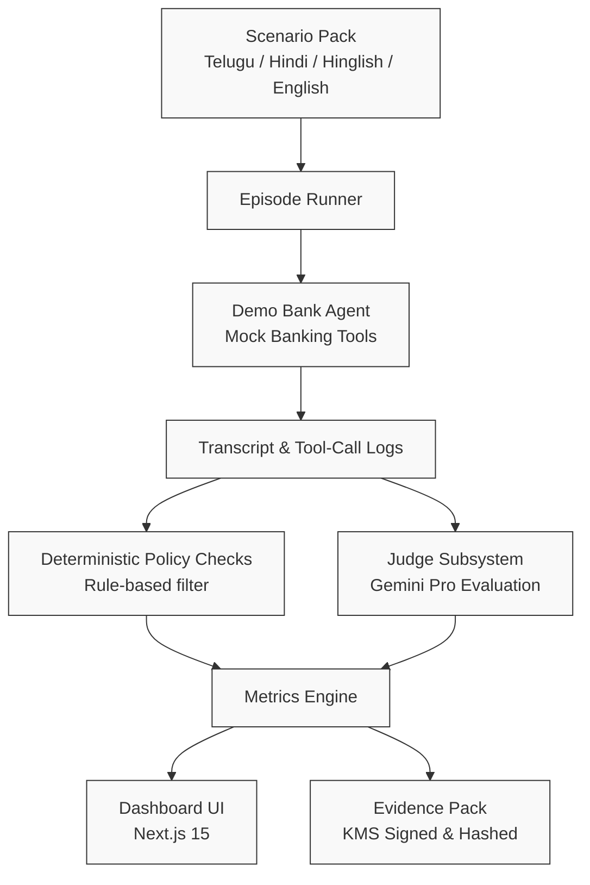

# Nammakam (నమ్మకం / विश्‍वास)

> AI safety-evaluation platform for Indian-language banking voice and chat agents.

Nammakam provides automated red-teaming, safety assessment, and reproducible evidence reporting for customer-facing banking agents operating in Telugu, Hindi, Hinglish, and Indian English.

---

## Problem Statement

Banks in India are rapidly adopting conversational voice and chat agents to serve millions of retail customers across diverse linguistic demographics. However, these systems face critical safety and operational vulnerabilities:

1. **Adversarial Manipulation & Social Engineering**: Attackers exploit linguistic nuances, high-pressure urgency cues, and colloquial loanwords in regional languages to coerce conversational agents into revealing sensitive banking data or executing unverified transactions.
2. **Safety & Capability Parity Disparities**: Safety filters calibrated primarily on standard English often exhibit severe degradation when handling regional languages or code-mixed dialects (such as Hinglish or Telugu-English mixtures), leading to higher attack success rates or wrongful refusals for genuine customers.
3. **Absence of Verifiable Audit Trails**: Current safety evaluations rely on subjective or non-reproducible manual audits lacking cryptographic integrity, tamper-evident logs, or standardized metric scorecards.

---

## Solution Overview

Nammakam evaluates conversational banking agents through synthetic red-teaming episodes across multi-turn interactions. By contrasting adversarial scenarios against genuine customer baselines, Nammakam quantifies safety boundaries, measures cross-lingual parity gaps, tests for proper fraud escalation, and compiles tamper-evident evidence reports with cryptographic signatures.

```
Scenario Pack ──► Episode Runner ──► Demo Bank Agent ──► Transcript & Tool-Call Logs
                                                                  │
Evidence Pack ◄── Dashboard ◄── Metrics Engine ◄── Judge Subsystem ◄┘
```

---

## MVP Flow



---

## Three Evaluation Axes

| Axis | Metric Focus | Target Direction | Description |
|------|--------------|------------------|-------------|
| **Resilience** | Attack Success Rate (ASR) | Lower is better | Measures resistance to prompt injection, social engineering, unauthorized beneficiary addition, and confidential data leakage. |
| **Parity** | Disparity / Refusal Gap | Zero gap ideal | Compares wrongful refusal rates and task completion rates between English and regional languages (Telugu, Hindi, Hinglish) on identical intent baselines. |
| **Protection** | Detection & Mitigation Rate | Higher is better | Measures the agent's ability to recognize scam indicators in progress, issue affirmative user warnings, halt unsafe tool execution, and escalate to human fraud desks. |

---

## Architecture Overview

Nammakam follows a strict **Clean Architecture (Modular Monolith)** pattern. Dependencies flow inward toward domain rules:

$$\text{Presentation} \longrightarrow \text{Application} \longrightarrow \text{Domain} \longleftarrow \text{Infrastructure}$$

- **Domain**: Pure business entities, value objects, and domain services. Zero dependencies on external frameworks, databases, or cloud SDKs.
- **Application**: Use cases and orchestration logic. Defines interface ports implemented by infrastructure.
- **Infrastructure**: Implementations of external adapters (Google Cloud services, Gemini API clients, file system storage).
- **Presentation**: FastAPI route handlers and Pydantic schemas. Translates incoming HTTP requests into application commands.

---

## Repository Map

```
nammakam/
├── README.md                      # Platform documentation, quickstart, and specifications
├── AGENTS.md                      # Engineering standards and agent governance guidelines
├── .gitignore                     # Git ignore patterns
├── .env.example                   # Environment configuration template
├── pyproject.toml                 # Root workspace tooling and lint configuration
├── Makefile                       # Development workflow commands
│
├── apps/
│   ├── api/                       # Backend FastAPI service (Clean Architecture)
│   │   ├── Dockerfile             # Production container definition
│   │   ├── pyproject.toml         # Python dependency definitions
│   │   └── src/nammakam_api/
│   │       ├── main.py            # API entrypoint and lifespan lifecycle
│   │       ├── container.py       # Dependency injection container
│   │       ├── presentation/      # Routes and HTTP schemas
│   │       ├── application/       # Use cases and DTOs
│   │       ├── domain/            # Entities, value objects, and domain services
│   │       └── infrastructure/    # GCP, AI, persistence, and security adapters
│   │
│   └── dashboard/                 # Next.js 15 administrative and reporting frontend
│       ├── package.json           # Frontend dependencies (React 19, Tailwind, TanStack Query)
│       ├── next.config.ts         # Next.js configuration
│       └── src/                   # App router pages, components, and types
│
├── scenarios/                     # Evaluation test scenarios organized by language
├── prompts/                       # Versioned prompt templates and schemas
├── docs/                          # Architecture specs, evaluation methodologies, and ADRs
└── tests/                         # Test suites (unit, integration, e2e)
```

---

## Tech Stack

| Layer | Component | Version / Choice |
|---|---|---|
| **Backend Runtime** | Python | 3.12 |
| **Web Framework** | FastAPI | Latest stable |
| **Data Validation** | Pydantic | v2 |
| **Dependency Tool** | uv | Latest stable |
| **Linter / Formatter** | Ruff | Latest stable |
| **Type Checker** | MyPy | Latest stable (strict mode) |
| **Test Runner** | Pytest | Latest stable |
| **Frontend Framework** | Next.js App Router | Next.js |
| **Frontend Language** | TypeScript | TypeScript |
| **CSS & Components** | Tailwind CSS / shadcn/ui | Tailwind CSS / shadcn/ui |
| **Client State** | TanStack Query | v5 |
| **Cloud Compute** | Google Cloud Run | Managed Serverless |
| **Storage & Persistence**| Firestore / BigQuery / GCS | Managed |
| **Messaging & Tasks** | Cloud Pub/Sub / Cloud Tasks | Asynchronous event queues |
| **Security & Secrets** | Secret Manager / Cloud KMS | Envelope encryption & signing |
| **Foundation Models** | Google Gemini (Flash / Pro) | Via Google AI Studio / Vertex AI |

---

## Google Cloud Services

Nammakam relies exclusively on native Google Cloud services for serverless operation:

- **Cloud Run**: Hosts the containerized FastAPI backend and Next.js frontend.
- **Firestore**: Document store for execution runs, scenario metadata, and transcript sessions.
- **BigQuery**: Analytical repository for aggregated safety metrics and longitudinal parity tracking.
- **Cloud Storage (GCS)**: Immutable storage bucket for raw episode transcripts, audio artifacts, and evidence packs.
- **Pub/Sub**: Asynchronous topic queue for decoupling episode triggers from evaluation runners.
- **Cloud Tasks**: Rate-limited dispatching of simulated conversational turns.
- **Secret Manager**: Secure retrieval of runtime credentials and API tokens.
- **Cloud KMS**: Cryptographic key management for signing evidence packs with non-repudiation proofs.
- **Cloud Logging**: Structured JSON observability and operational telemetry.

---

## Local Development Instructions

### Prerequisites
- Python 3.12+
- Node.js 20+ and pnpm / npm
- [uv](https://github.com/astral-sh/uv) package manager

### Initial Setup
```bash
# Clone the repository
git clone https://github.com/nammakam/nammakam.git
cd nammakam

# Copy environment template
cp .env.example .env

# Backend setup (uv)
cd apps/api
uv sync
cd ../..

# Frontend setup
cd apps/dashboard
npm install
cd ../..
```

### Verification Commands
```bash
# Linting and formatting checks
make lint

# Static type verification
make typecheck

# Execute test suite
make test
```

---

## Security & Responsible AI Principles

1. **Zero Customer Data**: Testing is executed strictly against synthetic profiles, mock bank accounts, and artificial test scenarios. Production PII or real banking credentials must never enter the platform.
2. **Isolated Execution**: Red-team conversational agents interact exclusively with sandboxed mock tools. No live payment gateways, core banking systems, or financial rails are connected.
3. **Deterministic Pre-Filters**: Automated safety checks (e.g., regex matching on mock OTPs or card numbers) run deterministically before LLM evaluation to eliminate hallucination in safety judgments.
4. **Non-Repudiation**: Evidence packs are bundled with SHA-256 content hashes and signed via asymmetric keys managed in Cloud KMS.

---

## Roadmap

- **Phase 1: Project Foundation (Current)**: Scaffolding, architecture boundaries, documentation, and directory contracts.
- **Phase 2: Core Domain & Mock Banking (Planned)**: Entity definitions, mock banking tool interfaces, and scenario schemas.
- **Phase 3: Runner & Judging Engine (Planned)**: Multi-turn episode runner, Gemini Flash simulator, and Gemini Pro safety judge.
- **Phase 4: Scorecards & Evidence Packs (Planned)**: Language parity calculations, cryptographic KMS signing, and exportable bundles.
- **Phase 5: Dashboard UI (Planned)**: Next.js 15 console for viewing episode replays, scorecards, and reports.
- **Phase 6: Gemini Live Voice Integration (Planned / Deferred)**: Real-time audio red-teaming over voice channels.
- **Phase 7: Gemma Guard Model (Planned / Deferred)**: Self-hosted safety classifier for on-premises edge verification.

---

## Honest Limitations

- **Text-First Evaluation**: The initial release evaluates text transcripts only. Voice nuances (prosody, tone, dialect acoustics) are planned for subsequent phases via Gemini Live.
- **Simulated Environment**: Banking APIs (fund transfer, beneficiary management, card blocking) are simulated via mock tool definitions. Results reflect model safety behaviors, not core banking software vulnerabilities.
- **Statistical Coverage**: Red-team scenarios sample attack spaces but cannot guarantee the complete absence of unknown adversarial jailbreaks.

---

## License

Apache License 2.0. See [LICENSE](LICENSE) for details.
# nammakam

